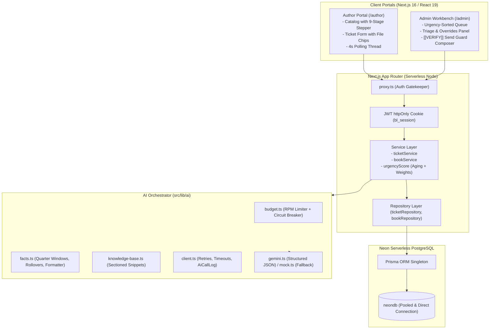

# BookLeaf Author Support & Communication Portal

> A high-reliability, AI-accelerated Author Support Portal and Admin Support Workbench engineered for **BookLeaf Publishing**. Built on **Next.js 16**, **Neon Serverless PostgreSQL**, **Prisma ORM**, and **Google Gemini 2.5 Flash**.

[](#)
[](#)
[](https://neon.tech)
[](https://nextjs.org)

---

## 1. Demo & Test Credentials

For quick evaluation, pre-seeded accounts are provided with credentials pre-fillable on the `/login` screen:

| Role | Name | Email | Password | Key Context / Test Cases |
| :--- | :--- | :--- | :--- | :--- |
| **Admin** | Priya Sharma | `priya@bookleaf.in` | `AdminPass123!` | Full triage queue, overrides, internal notes, reply composer |
| **Admin** | Rahul Verma | `rahul@bookleaf.in` | `AdminPass123!` | Secondary admin for assignment testing |
| **Author** | Ananya Roy | `ananya.roy@example.com` | `AuthorPass123!` | Published book (*Silent Screams*), ₹0 paid with ₹14,200 pending |
| **Author** | Vikram Seth | `vikram@example.com` | `AuthorPass123!` | Book in production (*Midnight in Mysore*), 9-stage stepper |
| **Author** | Kavita Rao | `kavita@example.com` | `AuthorPass123!` | Two books; *Nagpur Notebooks* has ₹850 pending (< ₹1,000 rollover) |

---

## 2. Architecture Diagram



---

## 3. Directory Layout

```text
bookleaf-portal/
├── prisma/
│   ├── schema.prisma            # Models: User, Book, Ticket, TicketMessage, InternalNote, AiCallLog
│   └── seed.ts                  # Seeds 12 users, 18 books, 12 realistic tickets
├── src/
│   ├── app/
│   │   ├── (auth)/login/        # Login page with demo autofill chips
│   │   ├── author/              # Author portal: Dashboard, Books (9-stage stepper), Tickets, Thread
│   │   ├── admin/               # Admin portal: Queue with Urgency scoring, Workbench with Triage & Composer
│   │   ├── api/                 # Thin route handlers: auth, books, tickets, classify, draft, admin stats
│   │   └── globals.css          # BookLeaf design tokens (#F2697A coral, #4FB3C8 teal, Lato font)
│   ├── components/
│   │   ├── ui/                  # UI Primitives: Button, Card, Badge, Input, Select, StatStrip, EmptyState
│   │   ├── author/              # AuthorNav, ProductionStepper
│   │   └── admin/               # AdminNav, UrgencyBadge
│   ├── lib/
│   │   ├── ai/                  # AI engine: budget, client, gemini, mock, facts, fallback, fallback-drafts
│   │   ├── auth/                # JWT cookie verification, rate-limiting, role guards
│   │   ├── http/                # Domain error hierarchy, handleRoute wrapper
│   │   └── tickets/             # Urgency scoring algorithm
│   ├── server/
│   │   ├── repositories/        # Database queries (Prisma)
│   │   └── services/            # Business logic, author serialization filters, status workflows
├── tests/
│   ├── unit/                    # Vitest unit tests: urgency, fallback (15 cases), facts, prompts, errors, budget, hygiene
│   └── api/                     # Vitest API integration: RBAC matrix, privacy leaks, state transitions
├── openapi.yaml                 # Complete OpenAPI 3.1.0 specification
├── VERIFICATION.md              # Detailed verification logs & test run proofs
└── WRITEUP.md                   # Architectural decisions, trade-offs, and scaling roadmap
```

---

## 4. Why Neon PostgreSQL?

BookLeaf Portal uses **Neon Serverless PostgreSQL** as its primary datastore:
1. **Serverless Architecture & Autoscaling:** Neon scales compute to zero during idle night periods and spins up instantly upon author requests, matching the variable load of publishing cycles.
2. **Connection Pooling by Default:** Utilizes `@neondatabase/serverless` connection pooler over port `5432` (`DATABASE_URL`), eliminating connection exhaustion issues common in serverless Next.js functions.
3. **Database Branching for Testing:** Neon allows creating instant copy-on-write database branches in seconds for running CI/CD test suites without polluting production data.
4. **Direct URL for Schema Migrations:** A dedicated direct connection (`DIRECT_URL`) bypasses poolers for transactional schema migrations with `prisma db push`.

---

## 5. Architectural Decisions & Why

### 5.1 Next.js 16 Route Handlers + Service Layer
Routes are kept strictly thin: `Validate input (Zod) → Invoke Service → Return serialized response`. All business logic (e.g. author data isolation, urgency scoring, draft cache invalidation, and auto-reopening resolved tickets upon author replies) lives inside `ticketService` and `bookService`.

### 5.2 Multi-Tenant Privacy by Default
Authors attempting to access another author's ticket by ID receive a **404 Not Found** (instead of a 403 Forbidden). This completely prevents ticket enumeration attacks. Furthermore, author serialization strips internal notes, AI confidence scores, AI rationales, and admin override history before the JSON envelope is sent to the client.

### 5.3 Short-Polling over WebSockets
Short-polling (4s on active ticket threads, 10s on queue) was chosen over WebSockets:
- **Serverless Resilience:** WebSockets require persistent Node servers or third-party socket infrastructure. Short-polling runs on native stateless serverless functions.
- **Battery & Bandwidth Friendly:** Polling automatically pauses via `document.visibilityState` when the author or admin switches browser tabs.

### 5.4 Unified AI Engine & Graceful Degradation
- **Facts-First Engine:** All facts (author name, sales, quarterly windows, rollover threshold status) are assembled in code (`facts.ts`) to prevent LLM hallucination.
- **Circuit Breaker & Token Bucket (`budget.ts`):** Proactively prevents exceeding Google AI Studio free-tier quotas (10 RPM / 500 daily calls) and opens cooldown on repeated 429 errors.
- **Deterministic Fallback (`fallback.ts` & `fallback-drafts.ts`):** If AI is offline, rate-limited, or configured in `AI_PROVIDER=mock`, the application continues operating seamlessly using rule-based triage and structured template drafts.
- **`[[VERIFY: ...]]` Guard:** The reply composer detects any unverified placeholders and enforces an explicit confirmation modal before sending.

---

## 6. AI Cost & Token Arithmetic

| Operation | Model | Input Tokens (Avg) | Output Tokens (Avg) | Cost per Call (Est.) |
| :--- | :--- | :---: | :---: | :---: |
| **Ticket Triage (Classify)** | Gemini 2.5 Flash | ~250 tokens | ~35 tokens | **~$0.00003** |
| **Draft Generation** | Gemini 2.5 Flash | ~450 tokens | ~150 tokens | **~$0.00008** |

- **Combined Triage Call:** One single call determines both Category and Priority simultaneously, halving latency and token consumption.
- **Sectioned KB:** Instead of sending the full 10,000-word Knowledge Base, the prompt builder injects *only* the specific section matching the ticket's category.
- **Lazy Draft Generation:** Drafts are only generated when an admin opens a ticket in the workbench, avoiding LLM costs on duplicate or auto-resolved tickets.
- **Estimated Cost per Ticket:** **< $0.00015** (~₹0.012 per ticket).

---

## 7. Local Setup & Running

### Prerequisites
- Node.js `>= 20.18.0`
- Free Neon Account ([neon.tech](https://neon.tech))

### Step 1: Clone & Install
```bash
git clone https://github.com/your-username/bookleaf-portal.git
cd bookleaf-portal
npm install
```

### Step 2: Configure Environment
Copy `.env.example` to `.env.local`:
```bash
cp .env.example .env.local
```
Fill in your Neon connection strings:
```env
DATABASE_URL="postgresql://[user]:[password]@[endpoint]-pooler.neon.tech/neondb?sslmode=require"
DIRECT_URL="postgresql://[user]:[password]@[endpoint].neon.tech/neondb?sslmode=require"
JWT_SECRET="generate-a-long-random-string"
AI_PROVIDER="mock"  # Switch to "gemini" when GEMINI_API_KEY is supplied
GEMINI_API_KEY=""
```

### Step 3: Initialize Database & Seed
```bash
npx prisma db push
npm run db:seed
```

### Step 4: Run Development Server
```bash
npm run dev
```
Open [http://localhost:3000](http://localhost:3000) in your browser.

---

## 8. Verification & Testing

Run the full automated test suite:
```bash
npm test
```
Run full verification protocol (Lint + TypeScript + Build + Tests):
```bash
npm run verify
```

---

## 9. API Documentation

Detailed OpenAPI 3.1.0 specifications are available in [`openapi.yaml`](./openapi.yaml).

| Endpoint | Method | Role | Description |
| :--- | :---: | :---: | :--- |
| `/api/auth/login` | `POST` | Public | Authenticates user and issues HTTP-only JWT cookie |
| `/api/auth/logout` | `POST` | Public | Clears session cookie |
| `/api/auth/me` | `GET` | Authenticated | Returns authenticated user profile |
| `/api/books` | `GET` | Author/Admin | Returns books for logged-in author or catalog for admin |
| `/api/tickets` | `GET` | Author/Admin | List tickets (filtered for author, full queue for admin) |
| `/api/tickets` | `POST` | Author | Create new ticket; triggers background AI triage |
| `/api/tickets/{id}` | `GET` | Author/Admin | Get ticket thread (strips internal notes for authors) |
| `/api/tickets/{id}` | `PATCH` | Admin | Override category, priority, status, or assignment |
| `/api/tickets/{id}/messages` | `POST` | Author/Admin | Post message in thread; reopens resolved tickets |
| `/api/tickets/{id}/notes` | `POST` | Admin | Add private internal note |
| `/api/tickets/{id}/draft` | `POST` | Admin | Retrieve or regenerate AI / template draft |
| `/api/tickets/{id}/classify` | `POST` | Admin | Re-trigger classification |
| `/api/tickets/{id}/assign-me`| `POST` | Admin | Assign ticket to requesting admin |
| `/api/admin/stats` | `GET` | Admin | Get workbench metrics (open count, AI calls today) |

---

## 10. License
Internal proprietary application developed for BookLeaf Publishing. All rights reserved.
